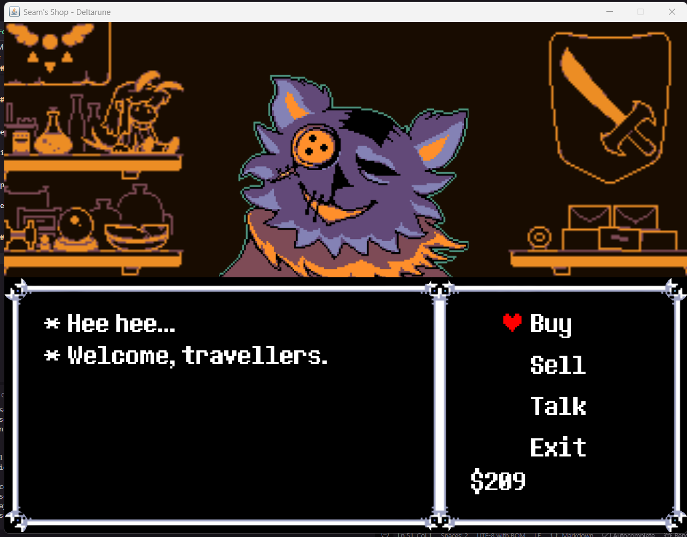
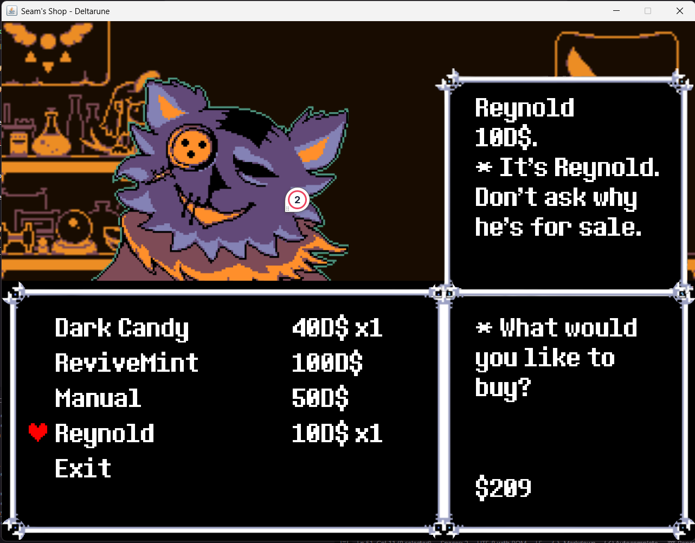

# Seam's Shop (Deltarune) - OOP Project

A recreation of Seam's shop from Deltarune Chapter 1, built in Java Swing for an OOP class.

## How to run

Requires Java 22+:

```
javac src/main.java src/BitmapFont.java
java -cp src main
```

Or run directly:

```
java src/main.java
```

If the pixels look blurry on Windows, try:

```
java -Dsun.java2d.uiScale=1.0 src/main.java
```

## Controls

- **Up/Down arrows** - move the heart cursor
- **Z or Enter** - select
- **X or Esc** - go back

## Features

- Menu with Buy / Sell / Talk / Exit options
- Heart cursor navigation
- Bitmap font rendering using the actual fnt_main font from the game
- Text container at the bottom of the window
- Background image at the top

## Files

- `src/main.java` - main entry point, handles drawing and keyboard input
- `src/BitmapFont.java` - loads and renders the fnt_main pixel font from sprite sheet + .yy glyph data
- `src/assets/` - sprites, sounds, and font files
- `src/assets/sprites/` - background, text container, heart sprite, and character sprites
- `src/assets/font/fnt_main/` - font sprite sheet and glyph metadata
- `src/assets/sound/` - music and sound effects

## Screenshots



